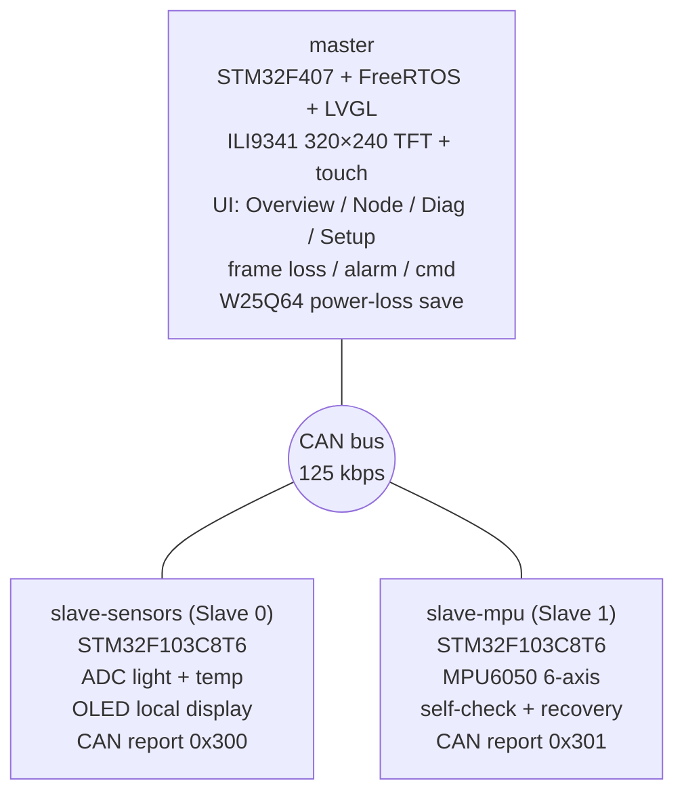
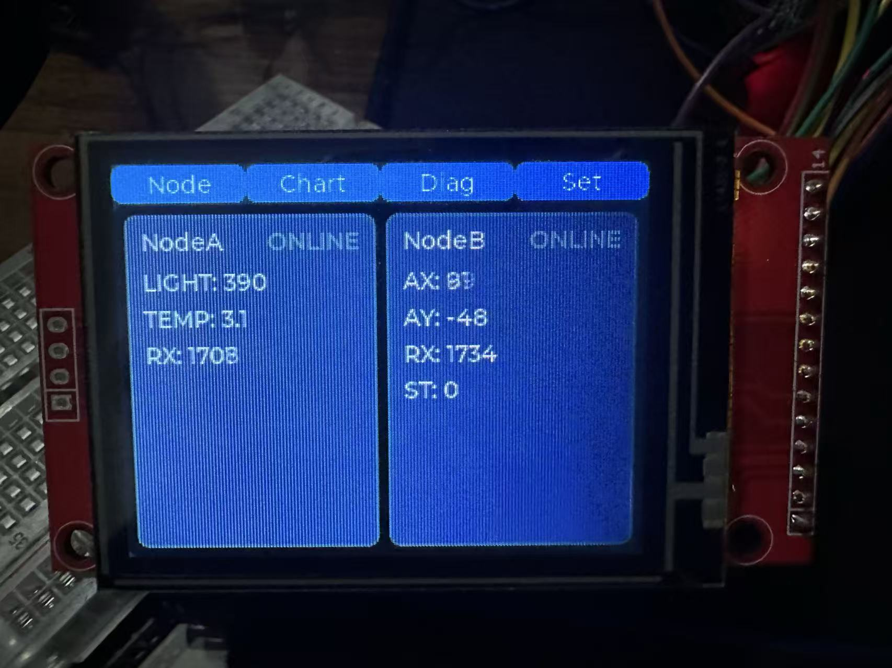
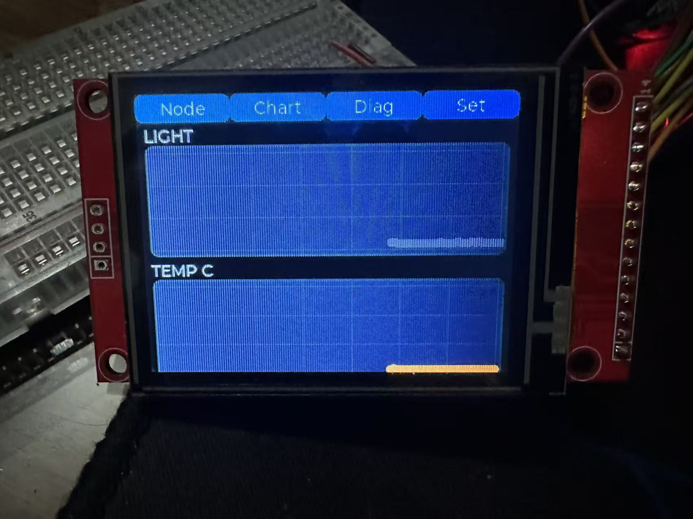
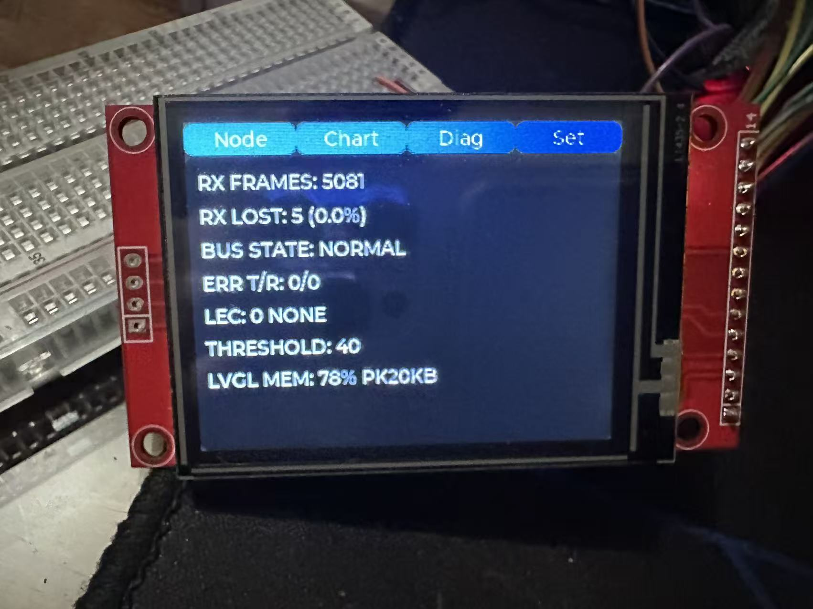
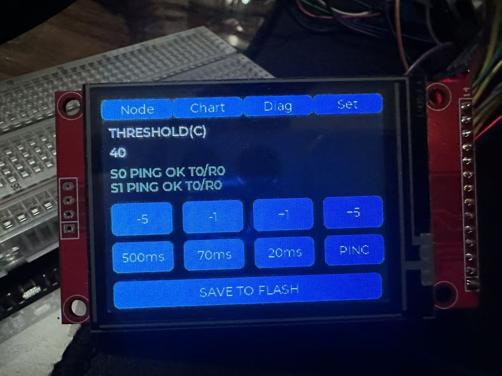
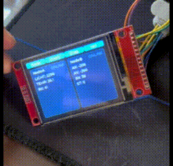
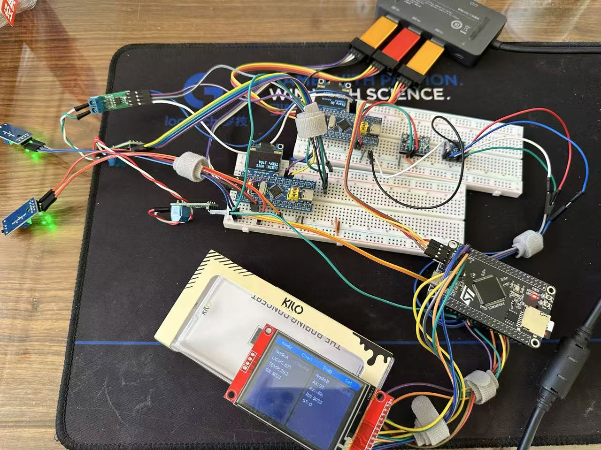

# Three-Node CAN Distributed Monitoring System

[](https://github.com/DuZhou08/can-monitor-system/actions/workflows/build.yml)    

A **master console** on **STM32F407 + FreeRTOS + LVGL** that aggregates two **STM32F103** slaves (light/temperature and MPU6050 attitude) over a **CAN bus (125 kbps)** — covering acquisition, live display, alarms, bidirectional commands, power-loss persistence, and bus-error diagnostics.

**English** | [简体中文](README.md)

## Table of Contents

- [System Architecture](#system-architecture)
- [UI Gallery](#ui-gallery)
- [Demo](#demo)
- [Nodes](#nodes)
- [Features](#features)
- [Hardware](#hardware)
- [CAN Protocol](#can-protocol)
- [Getting Started](#getting-started)
- [Repository Layout](#repository-layout)
- [Documentation Index](#documentation-index)
- [Roadmap](#roadmap)
- [License](#license)

## System Architecture



## UI Gallery

The master runs a 4-page LVGL touch UI, switched by touch:

| Overview | Live Charts |
| :---: | :---: |
|  |  |

| Diagnostics | Settings |
| :---: | :---: |
|  |  |

## Demo

Real-device demo — three nodes power up onto the bus, live data refresh,
touch page switching, and command dispatch:



## Nodes

| Project         | Role    | MCU           | CAN ID      | Responsibility                                           |
| --------------- | ------- | ------------- | ----------- | -------------------------------------------------------- |
| `master`        | Master  | STM32F407VET6 | receive all | data aggregation, LVGL UI, alarms, commands, persistence |
| `slave-sensors` | Slave 0 | STM32F103C8T6 | `0x300`     | dual-channel ADC (light / temperature), periodic report  |
| `slave-mpu`     | Slave 1 | STM32F103C8T6 | `0x301`     | MPU6050 attitude, fault self-check & recovery            |

## Features

- **CAN multi-node bus**: standard frames at 125 kbps, `StdId & 0xFF` = slave address; master has 4 exact RX filters
- **LVGL touch UI (master)**: Overview / Node / Diagnostics / Settings — live values + charts + alarm coloring
- **Bidirectional command protocol**: `SET_PERIOD` (remote report period 20~1000 ms), `PING`; slaves ACK back
- **Reliability**: frame-loss statistics by sequence number, 2 s disconnect detection, sequence re-sync after slave reboot
- **Bus error diagnostics**: read `CAN_ESR`, show TEC / REC / LEC / BOFF / EPVF / EWGF
- **Power-loss persistence**: W25Q64 SPI flash, magic + checksum, thresholds survive power loss
- **FreeRTOS multitasking**: periodic tasks (`vTaskDelayUntil`) + semaphore/queue event-driven

## Hardware

| Node    | Main components                                                                |
| ------- | ------------------------------------------------------------------------------ |
| Master  | STM32F407VET6 · ILI9341 320×240 (SPI2, HR2046 touch) · W25Q64 (SPI1) · TJA1050 |
| Slave 0 | STM32F103C8T6 · light/temperature sensors (ADC) · OLED · TJA1050               |
| Slave 1 | STM32F103C8T6 · MPU6050 (soft I2C) · OLED · TJA1050                            |

> Bus: 125 kbps, 120 Ω at both ends, common ground; wiring and schematic in [`docs/HARDWARE.md`](docs/HARDWARE.md).



*Three-node CAN setup in the flesh (master + two slaves)*

## CAN Protocol

| ID              | Direction              | Payload                             | DLC   |
| --------------- | ---------------------- | ----------------------------------- | ----- |
| `0x300`         | slave-sensors → master | light u16 · temp u16 · seq u8       | 5     |
| `0x301`         | slave-mpu → master     | AX i16 · AY i16 · state u8 · seq u8 | 6     |
| `0x310` `0x311` | slaves → master        | opcode · result · TEC · REC         | 4     |
| `0x500`         | master → slaves        | target · opcode · param u16         | 2 / 4 |

All multi-byte fields are **big-endian**; command codes `0x01` SET_PERIOD, `0x02` PING.
Full frame format, filter config, frame-loss/disconnect/diagnostic rules: see **[`docs/PROTOCOL.md`](docs/PROTOCOL.md)**.

## Getting Started

### Requirements

- `arm-none-eabi-gcc` (build)
- OpenOCD + ST-Link (flash)
- VSCode + **EIDE** extension (all three projects are EIDE-managed)

### Build & Flash

The three projects are independent — build and flash each one. Both master and slaves use VSCode + EIDE one-click build / flash.

### Run

On power-up the master shows the Overview page; the two slaves report at their own periods; touch to switch Node / Diagnostics / Settings.

## Repository Layout

Three sibling projects sharing one CAN protocol and doc conventions:

```
can-monitor-system/
├── master/                    # Master: F407 + FreeRTOS + LVGL
│   ├── MYapp/                 # App layer (UI / CAN monitor / tasks)
│   ├── commuication_protocol/ # Comm drivers (CAN / SPI)
│   ├── hardware/              # Board drivers (TFT / touch / flash)
│   ├── lvgl/                  # LVGL v9 source
│   └── user/ FreeRtos/ start/ library/ system/
├── slave-sensors/             # Slave 0: F103 light / temp
│   ├── app/ commuication_protocol/ hardware/
│   ├── scripts/               # flash.sh (OpenOCD)
│   └── docs/                  # EIDE setup docs
├── slave-mpu/                 # Slave 1: F103 MPU6050
│   ├── app/ commuication_protocol/ hardware/
│   ├── scripts/ docs/
└── docs/
    ├── PROTOCOL.md            # CAN protocol (shared)
    ├── HARDWARE.md            # Hardware / wiring / BOM + schematic
    └── PINOUT.md              # Pinout of all three boards
```

> Per-project convention: `app/` application · `commuication_protocol/` comm drivers · `hardware/` peripheral drivers · `user/` entry & config.

## Documentation Index

| Document                                             | Content                                                      |
| ---------------------------------------------------- | ------------------------------------------------------------ |
| [`docs/PROTOCOL.md`](docs/PROTOCOL.md)               | CAN frame format / ID map / commands / filters / diagnostics |
| [`docs/HARDWARE.md`](docs/HARDWARE.md)               | Hardware selection / wiring / schematic                      |
| [`docs/PINOUT.md`](docs/PINOUT.md)                   | Pinout of all three boards                                   |
| [`master/README.md`](master/README.md)               | Master project details                                       |
| [`slave-sensors/README.md`](slave-sensors/README.md) | Slave 0 details                                              |
| [`slave-mpu/README.md`](slave-mpu/README.md)         | Slave 1 details                                              |

## Roadmap

- [x] Three-node CAN networking (125 kbps)
- [x] Master LVGL touch UI (Overview / Node / Diagnostics / Settings)
- [x] Bidirectional commands (SET_PERIOD / PING) + ACK
- [x] Frame-loss stats / disconnect detection / bus-error diagnostics
- [x] W25Q64 power-loss persistence
- [x] Schematic (JLC EDA) → `docs/HARDWARE.md`
- [x] English docs (README / protocol)

## License

[MIT](LICENSE)
