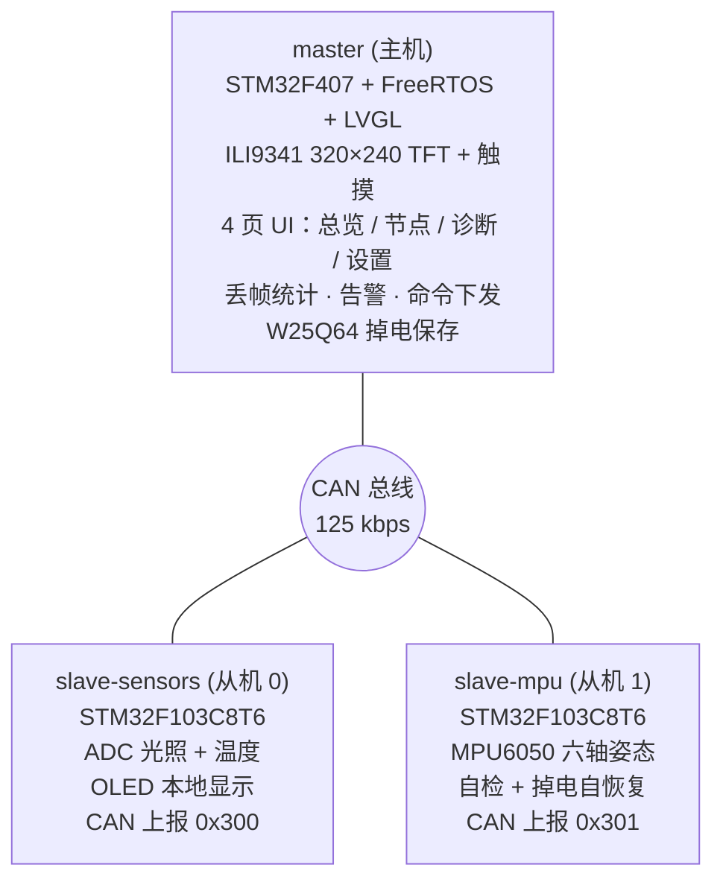

# 三节点 CAN 分布式监控系统

基于 **STM32F407 + FreeRTOS + LVGL** 的主机监控台，通过 **CAN 总线（125 kbps）** 汇聚两路 **STM32F103** 从机（光照/温度、MPU6050 姿态），实现采集、实时显示、告警、双向命令、掉电保存与总线错误诊断的完整闭环。

**简体中文** | [English](README.en.md)

## 目录

- [系统架构](#系统架构)
- [界面展示](#界面展示)
- [演示](#演示)
- [节点一览](#节点一览)
- [核心特性](#核心特性)
- [硬件](#硬件)
- [CAN 通信协议](#can-通信协议)
- [快速开始](#快速开始)
- [目录结构](#目录结构)
- [文档索引](#文档索引)
- [路线图](#路线图)
- [许可](#许可)

## 系统架构



## 界面展示

主机 LVGL 触摸 UI 共四页，触摸切换：

| 节点总览 | 实时曲线 |
| :---: | :---: |
|  |  |

| 故障诊断 | 节点设置 |
| :---: | :---: |
|  |  |

## 演示

三节点上电组网、数据实时刷新、触摸切页与命令下发的实拍演示：


## 节点一览

| 目录            | 角色   | MCU           | CAN ID   | 职责                                        |
| --------------- | ------ | ------------- | -------- | ------------------------------------------- |
| `master`        | 主机   | STM32F407VET6 | 接收全部 | 数据汇聚、LVGL 显示、告警、命令下发、持久化 |
| `slave-sensors` | 从机 0 | STM32F103C8T6 | `0x300`  | ADC 双通道（光照/温度）周期上报             |
| `slave-mpu`     | 从机 1 | STM32F103C8T6 | `0x301`  | MPU6050 姿态采集、故障自检自恢复            |

## 核心特性

- **CAN 总线多机通信**：标准帧 125 kbps，`StdId & 0xFF` 即从机地址；主机 4 组精确接收过滤器
- **LVGL 触摸 UI（主机）**：总览 / 节点 / 诊断 / 设置 四页，实时数值 + 曲线 + 告警着色
- **双向命令协议**：`SET_PERIOD`（远程改上报周期 20~1000 ms）、`PING` 在线探测，从机 ACK 回传
- **可靠性机制**：帧序号丢帧统计、2 s 断线检测、从机重启后序号重新对齐
- **总线错误诊断**：读取 `CAN_ESR`，显示 TEC / REC / LEC / BOFF / EPVF / EWGF
- **掉电保存**：W25Q64 SPI Flash，magic + 校验，阈值掉电不丢
- **FreeRTOS 多任务**：各节点均为定周期任务（`vTaskDelayUntil`）+ 信号量/队列事件驱动

## 硬件

| 节点   | 主要器件                                                                         |
| ------ | -------------------------------------------------------------------------------- |
| 主机   | STM32F407VET6 · ILI9341 320×240（SPI2，含 HR2046 触摸）· W25Q64（SPI1）· TJA1050 |
| 从机 0 | STM32F103C8T6 · 光照/温度传感器（ADC）· OLED · TJA1050                           |
| 从机 1 | STM32F103C8T6 · MPU6050（软件 I2C）· OLED · TJA1050                              |

> 总线：125 kbps，双端 120 Ω 终端，三节点共地；接线与原理图见 [`docs/HARDWARE.md`](docs/HARDWARE.md)。


*三节点 CAN 组网实物（主机 + 两从机）*

## CAN 通信协议

| ID              | 方向                 | 内容                                | DLC   |
| --------------- | -------------------- | ----------------------------------- | ----- |
| `0x300`         | slave-sensors → 主机 | 光照 u16 · 温度 u16 · 序号 u8       | 5     |
| `0x301`         | slave-mpu → 主机     | AX i16 · AY i16 · 状态 u8 · 序号 u8 | 6     |
| `0x310` `0x311` | 从机 → 主机          | 指令 · 结果 · TEC · REC             | 4     |
| `0x500`         | 主机 → 从机          | 目标 · 指令 · 参数 u16              | 2 / 4 |

多字节一律**大端**；命令码 `0x01` SET_PERIOD、`0x02` PING。
完整帧格式、过滤器配置、丢帧/断线/诊断规则见 **[`docs/PROTOCOL.md`](docs/PROTOCOL.md)**。

## 快速开始

### 环境依赖

- `arm-none-eabi-gcc`（编译）
- OpenOCD + ST-Link （烧录）
- VSCode + **EIDE** 插件（三工程均由 EIDE 管理）

### 编译 & 烧录

三个工程相互独立，分别构建后烧录：

主机与从机均使用 VSCode + EIDE 一键构建 / 烧录。


### 运行

主机上电进入总览页，两路从机按各自周期上报；触摸切换 节点 / 诊断 / 设置 页。

## 目录结构

三个工程为**兄弟目录**，共享一套 CAN 协议与文档约定：

```
can-monitor-system/
├── master/                    # 主机：F407 + FreeRTOS + LVGL
│   ├── MYapp/                 # 应用层（UI / CAN 监控 / 任务）
│   ├── commuication_protocol/ # 通信驱动（CAN / SPI）
│   ├── hardware/              # 板级驱动（TFT / 触摸 / Flash）
│   ├── lvgl/                  # LVGL v9 源码
│   └── user/ FreeRtos/ start/ library/ system/
├── slave-sensors/             # 从机 0：F103 光照 / 温度
│   ├── app/ commuication_protocol/ hardware/
│   ├── scripts/               # flash.sh（OpenOCD）
│   └── docs/                  # EIDE 环境文档
├── slave-mpu/                 # 从机 1：F103 MPU6050
│   ├── app/ commuication_protocol/ hardware/
│   ├── scripts/ docs/
└── docs/
    ├── PROTOCOL.md            # CAN 协议（三工程共享）
    ├── HARDWARE.md            # 硬件 / 接线 / BOM + 原理图
    └── PINOUT.md              # 三块板引脚表
```

> 每个工程内部约定：`app/` 应用层 · `commuication_protocol/` 通信驱动 · `hardware/` 外设驱动 · `user/` 入口与配置。

## 文档索引

| 文档                                                 | 内容                                        |
| ---------------------------------------------------- | ------------------------------------------- |
| [`docs/PROTOCOL.md`](docs/PROTOCOL.md)               | CAN 帧格式 / ID 分配 / 命令 / 过滤器 / 诊断 |
| [`docs/HARDWARE.md`](docs/HARDWARE.md)               | 硬件选型 / 接线 / 原理图                    |
| [`docs/PINOUT.md`](docs/PINOUT.md)                   | 三块板引脚分配                              |
| [`master/README.md`](master/README.md)               | 主机工程详解                                |
| [`slave-sensors/README.md`](slave-sensors/README.md) | 从机 0 详解                                 |
| [`slave-mpu/README.md`](slave-mpu/README.md)         | 从机 1 详解                                 |

## 路线图

- [x] 三节点 CAN 组网通信（125 kbps）
- [x] 主机 LVGL 触摸 UI（总览 / 节点 / 诊断 / 设置）
- [x] 双向命令（SET_PERIOD / PING）+ ACK
- [x] 丢帧统计 / 断线检测 / 总线错误诊断
- [x] W25Q64 掉电保存
- [x] 原理图（嘉立创 EDA）→ `docs/HARDWARE.md`
- [x] README / 协议文档英文化

## 许可

[MIT](LICENSE)
