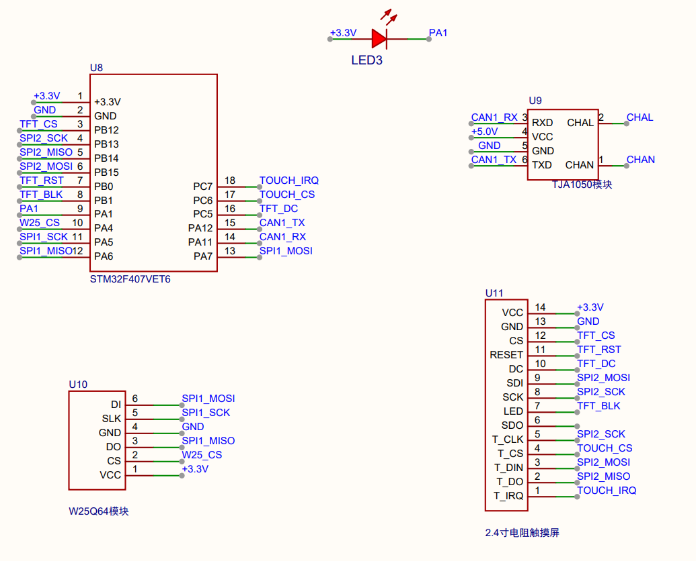
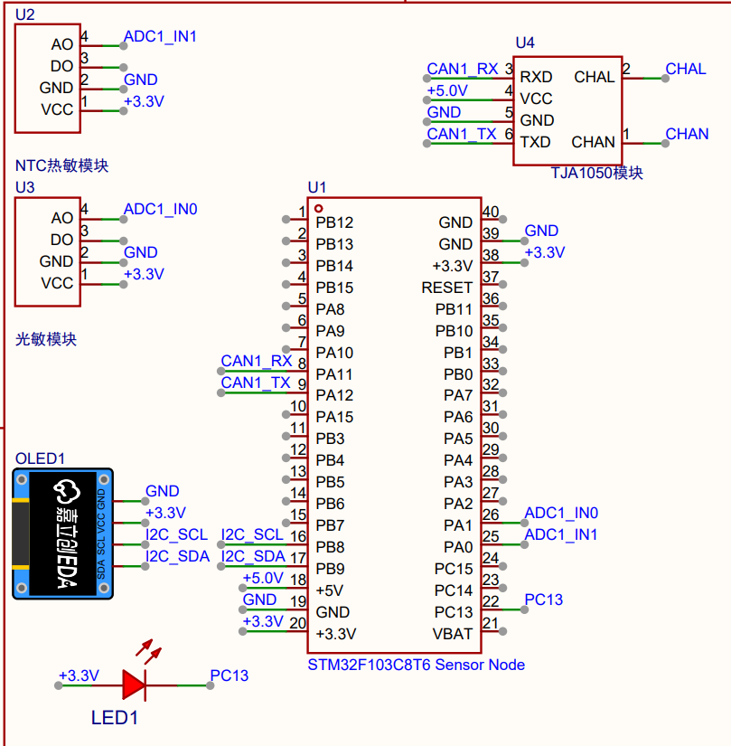
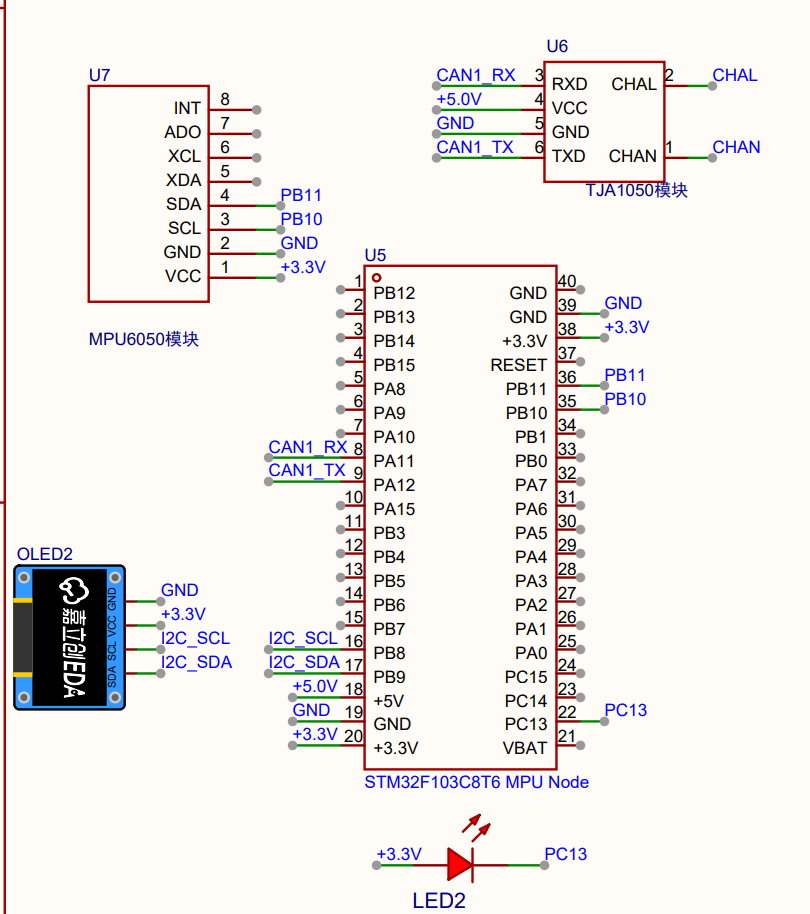

# Hardware

> v1.0 · 2026-10 · DuZhou

Three-node platform: **master (STM32F407VET6) + slave 0 (STM32F103C8T6) + slave 1 (STM32F103C8T6)**, interconnected over a **CAN bus (125 kbps)**.

**English** | [简体中文](HARDWARE.md)

- Pinout -> [`PINOUT.md`](PINOUT.md)
- CAN protocol -> [`PROTOCOL.md`](PROTOCOL.md)
- Schematic -> [`SCH_Schematic1_2026-10-07.pdf`](SCH_Schematic1_2026-10-07.pdf)

## System

- **Master** (STM32F407VET6): ILI9341 320x240 TFT + HR2046 touch (SPI2), W25Q64 flash (SPI1), TJA1050
- **Slave 0** (STM32F103C8T6): light + NTC modules (ADC), OLED (I2C), TJA1050
- **Slave 1** (STM32F103C8T6): MPU6050 (I2C), OLED (I2C), TJA1050
- Connected over a **CAN bus (125 kbps, twisted pair, 120 ohm each end, common ground)**

> Topology: see "System Architecture" in the root [`README.en.md`](../README.en.md).

## Bill of Materials (BOM)

### Master (master)
| Part            | Model / spec                                   | Qty | Notes                 |
| --------------- | ---------------------------------------------- | --- | --------------------- |
| MCU board       | STM32F407VET6 (168 MHz)                        | 1   | minimum system board  |
| TFT module      | ILI9341 2.4" SPI (14P, SD slot + HR2046 touch) | 1   | 320x240               |
| SPI flash       | W25Q64 (64 Mbit)                               | 1   | threshold persistence |
| CAN transceiver | TJA1050 module (onboard 120 ohm)               | 1   | **5 V supply**        |
| Work LED        | LED (active low)                               | 1   | heartbeat             |

### Slave 0 (slave-sensors)
| Part            | Model / spec                     | Qty | Notes                   |
| --------------- | -------------------------------- | --- | ----------------------- |
| MCU board       | STM32F103C8T6 (72 MHz)           | 1   | BluePill minimum system |
| Light sensor    | photoresistor module (GL5516)    | 1   | AO -> ADC               |
| Temp sensor     | NTC thermistor module            | 1   | AO -> ADC               |
| OLED            | SSD1306 0.96" 128x64 (I2C, 0x78) | 1   | local display           |
| CAN transceiver | TJA1050 module (onboard 120 ohm) | 1   | 5 V                     |
| Work LED        | onboard LED (PC13, active low)   | 1   | heartbeat               |

### Slave 1 (slave-mpu)
| Part            | Model / spec                     | Qty | Notes                   |
| --------------- | -------------------------------- | --- | ----------------------- |
| MCU board       | STM32F103C8T6 (72 MHz)           | 1   | BluePill minimum system |
| 6-axis IMU      | MPU6050 (I2C, 0x68)              | 1   | accel + gyro            |
| OLED            | SSD1306 0.96" 128x64 (I2C, 0x78) | 1   | local display           |
| CAN transceiver | TJA1050 module (onboard 120 ohm) | 1   | 5 V                     |
| Work LED        | onboard LED (PC13, active low)   | 1   | heartbeat               |

### Common
| Part            | Model / spec                     | Qty | Notes                              |
| --------------- | -------------------------------- | --- | ---------------------------------- |
| CAN transceiver | TJA1050 module (onboard 120 ohm) | 3   | one per node                       |
| Termination     | 120 ohm (onboard)                | 2   | built into each transceiver module |
| Power           | 5 V / 3.3 V                      | -   | common ground                      |

## Wiring

### CAN bus
| Item        | Description                                                |
| ----------- | ---------------------------------------------------------- |
| Speed       | 125 kbps (PSC master 56 / slave 48)                        |
| Pins        | PA11 = CAN_RX -> TJA1050 RXD; PA12 = CAN_TX -> TJA1050 TXD |
| Transceiver | TJA1050, VCC = 5 V                                         |
| Termination | 120 ohm at **both ends**                                   |
| Wiring      | CANH / CANL **twisted pair**, **common ground**            |

### Master wiring
| Peripheral     | Signal                 | Pins                   |
| -------------- | ---------------------- | ---------------------- |
| ILI9341        | SCK / MOSI / MISO      | PB13 / PB15 / PB14     |
| ILI9341        | CS / DC / BKL / RST    | PB12 / PC5 / PB1 / PB0 |
| HR2046 (touch) | CS / IRQ               | PC6 / PC7              |
| W25Q64         | CS / SCK / MISO / MOSI | PA4 / PA5 / PA6 / PA7  |
| TJA1050        | RXD / TXD              | PA11 / PA12            |
| Work LED       | LED1                   | PA1                    |

### Slave 0 (slave-sensors) wiring
| Peripheral   | Signal    | Pins           |
| ------------ | --------- | -------------- |
| Light module | AO        | PA0 (ADC1_IN0) |
| NTC module   | AO        | PA1 (ADC1_IN1) |
| OLED         | SCL / SDA | PB8 / PB9      |
| TJA1050      | RXD / TXD | PA11 / PA12    |
| Work LED     | onboard   | PC13           |

### Slave 1 (slave-mpu) wiring
| Peripheral | Signal    | Pins        |
| ---------- | --------- | ----------- |
| MPU6050    | SCL / SDA | PB10 / PB11 |
| OLED       | SCL / SDA | PB8 / PB9   |
| TJA1050    | RXD / TXD | PA11 / PA12 |
| Work LED   | onboard   | PC13        |

## Power
- All three nodes: **5 V**, **common ground**
- **TJA1050 must be 5 V** (3.3 V causes slave dropout)
- Boards / MCU use onboard LDO for 3.3 V

## Schematic

- Full PDF: [`SCH_Schematic1_2026-10-07.pdf`](SCH_Schematic1_2026-10-07.pdf) (exported from JLC EDA)

### Master (master)

### Slave 0 (slave-sensors)

### Slave 1 (slave-mpu)

## Known issues / notes
- **Termination**: modules carry onboard 120 ohm; three nodes measure **3 x 120 = 40 ohm** (over-terminated). Acceptable for <1 m / 125 kbps; the spec is 120 ohm at both ends only.
- **TJA1050 supply**: early 3.3 V supply caused frequent slave dropout; unified **5 V** gives `ERR T/R = 0/0`.
- **Temperature calibration**: NTC single-point calibration (26 C <-> ADC 1750); non-linearity noted in `PROTOCOL.md`.
