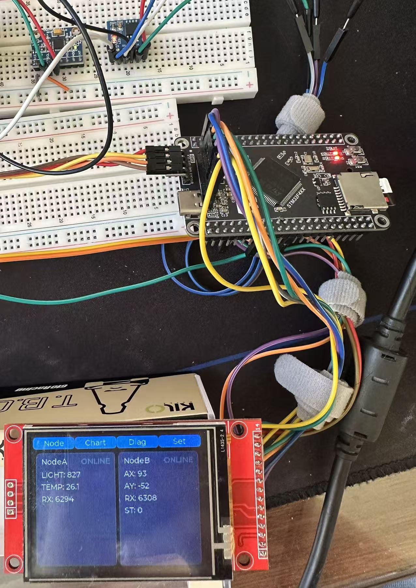

# master — 主机监控台 (STM32F407VET6)

STM32F407 + FreeRTOS + LVGL 的 CAN 监控台：汇聚两路从机（光照/温度、MPU6050 姿态），触摸屏显示 / 告警 / 诊断，支持双向命令与掉电保存。

**简体中文** | [English](README.en.md)

> 共享文档：[根 README](../README.md) · [协议](../docs/PROTOCOL.md) · [引脚](../docs/PINOUT.md) · [硬件](../docs/HARDWARE.md)

## 功能

- 触摸 UI 四页：总览 / 节点 / 诊断 / 设置（实时数值 + 曲线 + 告警着色）
- 汇聚 `0x300` / `0x301`：丢帧统计、2s 断线检测
- 双向命令：下发 `0x500`（SET_PERIOD / PING），收 `0x310` / `0x311` ACK
- 总线错误诊断：TEC / REC / LEC / BOFF
- 阈值掉电保存（W25Q64 SPI Flash）

## 任务

| 任务        | 优先级 | 栈   | 职责                          |
| ----------- | ------ | ---- | ----------------------------- |
| `vTaskLVGL` | 1      | 2048 | LVGL 渲染 + 触摸 + 心跳灯     |
| `CAN_Task`  | 2      | 256  | 轮询 CAN FIFO → 数据层 / 诊断 |

## 硬件

STM32F407VET6 · ILI9341 320×240（SPI2）+ HR2046 触摸 · W25Q64（SPI1）· TJA1050（5V）。详见 [`HARDWARE.md`](../docs/HARDWARE.md)。



*主机：STM32F407VET6 + ILI9341 TFT + W25Q64 + TJA1050*

## 构建 & 烧录

VSCode + **EIDE** 一键构建 / 烧录（arm-none-eabi-gcc）。

## 目录

```
MYapp/                 应用层（LVGL UI / CAN 监控 / 任务）
commuication_protocol/ 通信驱动（CAN / SPI）
hardware/              板级驱动（TFT / 触摸 / Flash / LED）
user/  lvgl/  FreeRtos/  system/  start/  library/
```
