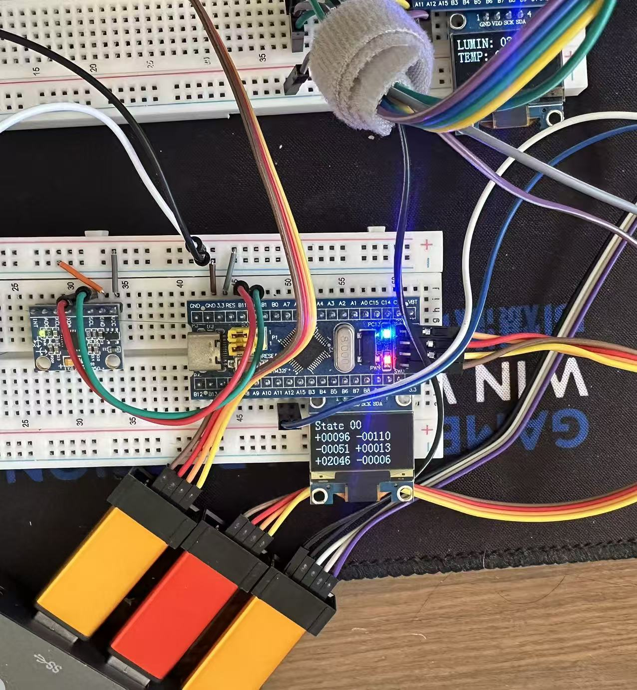

# slave-mpu — Slave 1 (STM32F103C8T6)

Slave 1 of the three-node CAN system: MPU6050 6-axis attitude acquisition with self-check / self-recovery, OLED display, periodic report to the master.

**English** | [简体中文](README.md)

> Shared docs: [root README](../README.en.md) · [protocol](../docs/PROTOCOL.en.md) · [pinout](../docs/PINOUT.en.md) · [hardware](../docs/HARDWARE.en.md)

## Features

- MPU6050 6-axis acquisition (soft I2C)
- Self-check / recovery: re-init on `WHO_AM_I` loss; auto-wake on all-zero (SLEEP); 3-strike anomaly debounce
- Periodic report `0x301` (DLC=6): AX i16 · AY i16 · state u8 · seq u8
- Command `0x500` -> ACK `0x311` (with TEC / REC)
- Bus-off self-recovery; live OLED display

## Tasks

| Task          | Priority | Period | Responsibility                             |
| ------------- | -------- | ------ | ------------------------------------------ |
| `vTaskLED`    | 1        | 500 ms | heartbeat LED (onboard PC13)               |
| `vTaskOLED`   | 1        | 70 ms  | show 6-axis + state                        |
| `vTaskMPU`    | 2        | 70 ms  | self-check / read / evaluate               |
| `vTaskCAN_TX` | 1        | 70 ms  | report `0x301` (critical-section snapshot) |
| `vTaskCAN_RX` | 3        | 5 ms   | claim command + send ACK                   |

> The `vTaskCAN_TX` period can be changed by the master via SET_PERIOD (20~1000 ms).

## Concurrency

`AX` / `AY` / `MCU_State` are written by `vTaskMPU` and read by `vTaskCAN_TX` inside a **critical-section snapshot**, preventing cross-task tearing.

## Hardware

STM32F103C8T6 · MPU6050 (I2C 0x68) · OLED (I2C 0x78) · TJA1050 (5 V). See [`HARDWARE.md`](../docs/HARDWARE.en.md).



*Slave 1: STM32F103C8T6 + MPU6050 + OLED + TJA1050*

## Build & Flash

VSCode + **EIDE** build; or `bash scripts/flash.sh` (OpenOCD + ST-Link).

## Layout

```
app/                   application (tasks / framing)
commuication_protocol/ comm drivers (CAN / I2C; UART reserved for debug)
hardware/              board drivers (MPU6050 / OLED / LED)
```
