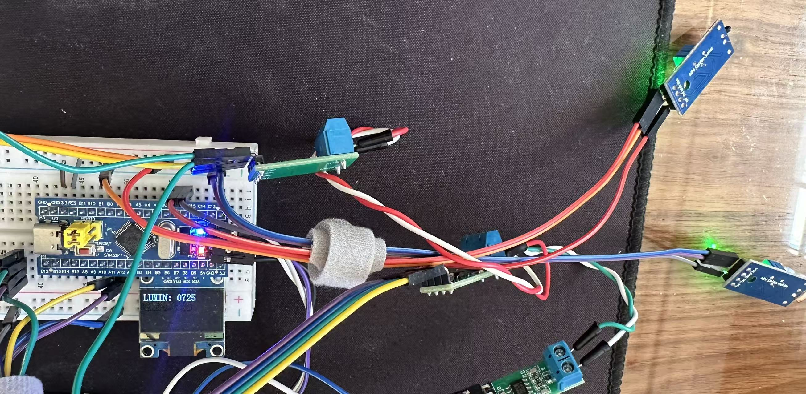

# slave-sensors — 从机 0 (STM32F103C8T6)

三节点 CAN 系统的从机 0：ADC 采集光照 / 温度，OLED 本地显示，周期上报主机，响应命令并回 ACK。

**简体中文** | [English](README.en.md)

> 共享文档：[根 README](../README.md) · [协议](../docs/PROTOCOL.md) · [引脚](../docs/PINOUT.md) · [硬件](../docs/HARDWARE.md)

## 功能

- ADC 双通道（光敏 GL5516 / NTC），ADC1 + DMA 循环采集
- 周期上报 `0x300`（DLC=5）：光照 u16 · 温度 u16 · 帧序号
- 命令 `0x500`（SET_PERIOD / PING）→ ACK `0x310`（含 TEC / REC）
- 丢帧序号、bus-off 自恢复；OLED 实时显示

## 任务

| 任务          | 优先级 | 周期  | 职责                |
| ------------- | ------ | ----- | ------------------- |
| `vTaskLED`    | 1      | 500ms | 心跳灯（板载 PC13） |
| `vTaskOLED`   | 1      | 70ms  | 显示光照 / 温度     |
| `vTaskCAN_TX` | 1      | 70ms  | 组帧上报 `0x300`    |
| `vTaskCAN_RX` | 2      | 5ms   | 认领命令 + 回 ACK   |

> `vTaskCAN_TX` 周期可被主机 SET_PERIOD 修改（20~1000 ms）。

## 并发设计

ADC 由 DMA 持续写入 `ADC_Value[]`；DMA 完成中断把**同轮快照**打包进**邮箱队列**（长度 1），OLED / CAN 任务用 `xQueuePeek` 读取最新值。每个共享变量单写者。

## 硬件

STM32F103C8T6 · 光敏(ADC) + NTC(ADC) · OLED（I2C）· TJA1050（5V）。详见 [`HARDWARE.md`](../docs/HARDWARE.md)。



*从机 0：STM32F103C8T6 + 光照/温度传感器 + OLED + TJA1050*

## 构建 & 烧录

VSCode + **EIDE** 构建；或命令行 `bash scripts/flash.sh`（OpenOCD + ST-Link）。

## 目录

```
app/                   应用层（任务 / 组帧）
commuication_protocol/ 通信驱动（CAN；UART 为预留调试口）
hardware/              板级驱动（ADC / OLED / LED）
```
